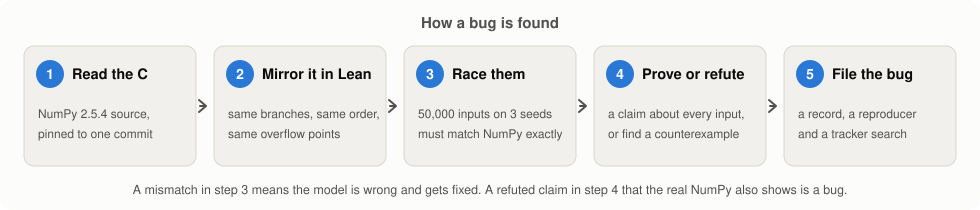
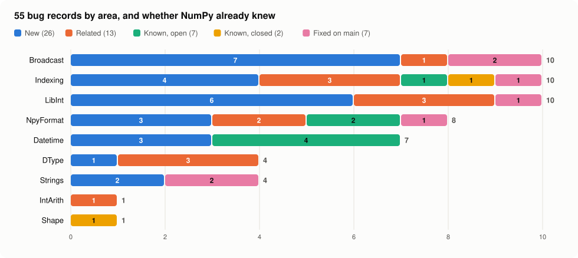

<h1 align="center">NumPy Lean Check</h1>

<p align="center">Part of NumPy, copied line by line into a proof assistant and raced against the real library 7.5 million times. It found 55 bugs, and 26 of them had never been reported.</p>

<p align="center">
  
  
  
  
</p>

NumPy is one of the most tested libraries in the world. This is what one line of it does today:

```python
>>> import numpy as np
>>> np.bincount([2**63 - 1])
array([], dtype=int64)
```

The documentation says the answer has length `max(x) + 1`, so it should be enormous. Instead it is empty, and NumPy has just written 8 bytes of memory that it does not own. Run it in a loop and Python crashes. Nobody had reported this one. The model in this repository found it by proving that a claim in NumPy's own documentation is false.

A few more of the 55, all from NumPy 2.5.4:

```python
>>> np.datetime64('2300-01-01', 'ns')           # a date in the 24th century
np.datetime64('1715-06-13T00:25:26.290448384')
>>> np.datetime64(' -2000')                    # a leading space eats the minus sign
np.datetime64('2000')
>>> np.datetime64('1971', 'Y') == np.datetime64(26, '14D')   # the right side is 31 December 1970
np.True_
>>> np.transpose(np.zeros((2, 3)), (2**32, 1)).shape         # axis 4294967296 is taken as axis 0
(2, 3)
```

## How it works, for people who have never used Lean

[Lean](https://lean-lang.org) is a programming language that is also a proof checker. You can write a function in it, run it like any other program, and then state a claim about every possible input, such as "the output is always at least as long as the largest number plus one". Lean only accepts the claim if you give it a proof that it checks step by step. If the claim is false, you prove that instead, by giving one input where it fails.

The project uses that in five steps.

<p align="center">
  <picture>
    <source media="(prefers-color-scheme: dark)" srcset="docs/images/pipeline-dark.svg">
    
  </picture>
</p>

1. **Read the C.** Every model starts from the NumPy 2.5.4 source, pinned to one commit, and cites the file and line it copies.
2. **Mirror it in Lean.** The Lean version keeps the same branches in the same order. Where the C code works with 64-bit integers that can overflow, the Lean version wraps at exactly the same place. The model describes what the code does, which is not always what the documentation says.
3. **Race them.** A Python script makes 50,000 random inputs, biased toward awkward values such as zero, negative numbers and the edges of 2**31, 2**32 and 2**63. It runs each input through the Lean model and through the real NumPy and compares the two answers as text. Every one of the 50 tests has to agree on all 50,000 inputs for three different random seeds. When they disagree, the model is wrong and gets fixed. The expected side is never edited.
4. **Prove or refute.** Once the model matches the library, it is safe to ask it questions that testing cannot answer, because a proof covers every input and not just the ones that were tried. Claims come from the docstrings, from comments in the C source and from plain consistency, for example that the scalar and array paths of an operation agree.
5. **File the bug.** A claim that turns out false, and that the real NumPy also gets wrong, becomes a bug record with a script that reproduces it. Behaviour that the documentation already warns about is kept as a refuted claim and is not counted as a bug.

### One bug from start to finish

Here is the `bincount` bug at each step. The C code in `numpy/_core/src/multiarray/compiled_base.c` sets the length of the output to the largest input plus one, and then counts into it.

```c
ans_size = mx + 1;                    /* line 222: no overflow check */
if (mlength != Py_None) {
    if (ans_size < minlength) {
        ans_size = minlength;
    }
}
...
for (i = 0; i < len; i++)
    ians[numbers[i]] += 1;            /* line 236: writes at numbers[i] */
```

The Lean model in `lean/NumpyLean/LibInt/Model.lean` copies those lines. `wrap64` makes the 64-bit overflow visible, where in C it happens silently.

```lean
let size := max (wrap64 (mx + 1)) minlength
```

The documentation promises that every input is a valid position in the output. The theorem in `lean/NumpyLean/LibInt/Props.lean` states the opposite and proves it with one input. If `mx` is `2**63 - 1`, then `mx + 1` wraps to a negative number, the `minlength` step replaces it with 0, and the loop writes to position `2**63 - 1` of an empty array.

```lean
/-- PROP libint.bincount.indices_in_bounds : REFUTED -/
theorem bincount_in_bounds_refuted :
    ¬ (∀ l m cap n cs, bincount l m cap = .ok (n, cs) → ∀ x ∈ l, x < n) := by
  intro h
  have := h [intpMax] 0 64 0 [] (by decide +kernel) intpMax (by simp)
  exact absurd this (by decide +kernel)
```

The race in step 3 had already shown that the model and NumPy give the same output length for this input, so the theorem is about the real library and not just the model. The bug record and its reproducer are [bugs/libint-bincount-max-intp-out-of-bounds.yaml](bugs/libint-bincount-max-intp-out-of-bounds.yaml) and [bugs/repro/libint-bincount-max-intp-out-of-bounds.py](bugs/repro/libint-bincount-max-intp-out-of-bounds.py).

## What it found

<p align="center">
  <picture>
    <source media="(prefers-color-scheme: dark)" srcset="docs/images/findings-dark.svg">
    
  </picture>
</p>

There are 55 bug records. Five are high severity, which means a memory error or silently wrong numbers on ordinary input. Eighteen are medium and 32 are low. Every record has a reproducer that prints `REPRODUCED`, and all 55 do on NumPy 2.5.4.

On 12 November 2026 each record was searched for in the open and closed issues and pull requests of NumPy, and the code it cites was compared with NumPy's main branch. The **Upstream** column gives the result.

- **New** means no issue or pull request describes the bug and main still has the faulty code.
- **Related** means an existing report shares the cause but does not describe this symptom.
- **Known** means an open or closed issue or pull request already covers it.
- **Fixed on main** means NumPy fixed it after 2.5.4 was released. These were found here independently, but upstream got there first.

### High severity

| What goes wrong | Area | Upstream | Record |
| --- | --- | --- | --- |
| `bincount` wraps the output length for the value 2**63 - 1 and then writes before the start of the output buffer | LibInt | **New** | [record](bugs/libint-bincount-max-intp-out-of-bounds.yaml) |
| `astype` from datetime64 years or months to a finer unit wraps silently instead of raising `OverflowError` | Datetime | Known, open [numpy#32218](https://github.com/numpy/numpy/pull/32218) | [record](bugs/datetime-nonlinear-cast-wraps.yaml) |
| `datetime64` from a string with an explicit unit wraps silently when the date does not fit the unit | Datetime | Known, open [numpy#9956](https://github.com/numpy/numpy/issues/9956) | [record](bugs/datetime-parse-unit-overflow-wraps.yaml) |
| `repeat` wraps the output length on overflow and then writes past the end of the output buffer | Indexing | Known, open [numpy#33080](https://github.com/numpy/numpy/issues/33080) | [record](bugs/indexing-repeat-count-overflow.yaml) |
| The `memoryview` format of a structured dtype drops the padding inside it, so `np.array(memoryview(a))` reads fields from the wrong bytes or crashes | NpyFormat | Known, open [numpy#7797](https://github.com/numpy/numpy/issues/7797) | [record](bugs/npyformat-pep3118-struct-element-padding-dropped.yaml) |

### Medium severity

| What goes wrong | Area | Upstream | Record |
| --- | --- | --- | --- |
| `broadcast_shapes` with more than 64 arguments depends on the order of the arguments | Broadcast | **New** | [record](bugs/broadcast-shapes-order-beyond-64-args.yaml) |
| `transpose` accepts axes outside the array by keeping only the low 32 bits of each axis | Broadcast | **New** | [record](bugs/broadcast-transpose-axis-truncated-to-int.yaml) |
| `datetime64` years or months compare equal to a different day because the common unit gets a stray factor of 7 | Datetime | **New** | [record](bugs/datetime-compare-nonlinear-common-unit.yaml) |
| `datetime64` parsing drops the minus sign of a year when the string starts with whitespace | Datetime | **New** | [record](bugs/datetime-parse-leading-space-drops-sign.yaml) |
| `unpackbits` returns uninitialised memory instead of zero padding when the input is empty and count is positive | LibInt | **New** | [record](bugs/libint-unpackbits-empty-count-uninitialized.yaml) |
| `result_type` and `concatenate` fail for float16, bytes and object in that order but give object in every other order | DType | Related [numpy#10554](https://github.com/numpy/numpy/pull/10554) | [record](bugs/dtype-result-type-order-half-string-object.yaml) |
| `ravel_multi_index` with mode clip or wrap gives the wrong index for coordinates of 2**63 or more | Indexing | Related [numpy#23607](https://github.com/numpy/numpy/issues/23607) | [record](bugs/indexing-ravel-multi-index-uint64-wraps.yaml) |
| `take` with mode clip or wrap gives the wrong element for uint64 indices of 2**63 or more | Indexing | Related [numpy#25607](https://github.com/numpy/numpy/issues/25607) | [record](bugs/indexing-take-uint64-clip-wraps.yaml) |
| `histogram` puts int64 and uint64 values above 2**53 in the wrong bin because the data is rounded to float64 | LibInt | Related [numpy#8627](https://github.com/numpy/numpy/issues/8627) | [record](bugs/libint-histogram-int64-rounds-to-double.yaml) |
| `isin` reports false matches between int64 and uint64 arrays on the sort path, so its `kind` options disagree | LibInt | Related [numpy#25386](https://github.com/numpy/numpy/issues/25386) | [record](bugs/libint-isin-sort-mixed-sign-float.yaml) |
| `np.array(memoryview(a))` raises `RuntimeError` for a length one array of a packed structured dtype | NpyFormat | Related [numpy#7797](https://github.com/numpy/numpy/issues/7797) | [record](bugs/npyformat-pep3118-length-one-struct-round-trip.yaml) |
| `busday_count` never returns for two dates more than 2**63 days apart | Datetime | Known, open [numpy#33185](https://github.com/numpy/numpy/pull/33185) | [record](bugs/datetime-busday-count-hang.yaml) |
| `take`, `put` and `choose` with mode wrap take time proportional to the index value | Indexing | Known, closed [numpy#28630](https://github.com/numpy/numpy/issues/28630) | [record](bugs/indexing-wrap-mode-linear-loop.yaml) |
| `insert` accepts negative out-of-bounds indices when obj has several elements | Broadcast | Fixed on main [numpy#31777](https://github.com/numpy/numpy/issues/31777) | [record](bugs/broadcast-insert-multiple-negative-out-of-range.yaml) |
| `take` with mode wrap never returns on an empty axis when the output is empty | Indexing | Fixed on main [numpy#32991](https://github.com/numpy/numpy/pull/32991) | [record](bugs/indexing-take-wrap-empty-axis-hang.yaml) |
| `digitize` checks the direction of int64 bins on doubles, so it accepts non-monotonic bins and misreads decreasing ones | LibInt | Fixed on main [numpy#32467](https://github.com/numpy/numpy/pull/32467) | [record](bugs/libint-digitize-int-bins-double-monotonic.yaml) |
| `strip`, `lstrip` and `rstrip` on `StringDType` miss ASCII characters in a chars argument that has multi-byte characters | Strings | Fixed on main [numpy#33133](https://github.com/numpy/numpy/pull/33133) | [record](bugs/strings-stringdtype-strip-chars-multibyte.yaml) |
| `find` and `count` on a `str_` array give wrong results for long haystacks with some long needles | Strings | Fixed on main [numpy#33176](https://github.com/numpy/numpy/pull/33176) | [record](bugs/strings-ucs4-two-way-periodic-memcmp.yaml) |

<details>
<summary><b>Low severity (32 records)</b></summary>

| What goes wrong | Area | Upstream | Record |
| --- | --- | --- | --- |
| `insert` accepts a boolean mask of the wrong length where `delete` raises `ValueError` | Broadcast | **New** | [record](bugs/broadcast-insert-bool-mask-length-unchecked.yaml) |
| `pad` with a huge scalar or pair width wraps the new shape and gives a misleading error | Broadcast | **New** | [record](bugs/broadcast-pad-scalar-width-wraps.yaml) |
| `broadcast_shapes` names the wrong arguments in the mismatch error after 64 arguments | Broadcast | **New** | [record](bugs/broadcast-shapes-mismatch-arg-numbers.yaml) |
| `split` raises `ZeroDivisionError` for zero sections where `array_split` raises `ValueError` | Broadcast | **New** | [record](bugs/broadcast-split-zero-sections-zerodivision.yaml) |
| `np.broadcast` and `broadcast_shapes` reject a zero-size shape when an overflowing product comes before the zero | Broadcast | **New** | [record](bugs/broadcast-zero-size-overflow-depends-on-position.yaml) |
| A Python int just below the float32 limit becomes inf because it is rounded to a double first | DType | **New** | [record](bugs/dtype-bigint-float32-double-rounding.yaml) |
| `datetime64` parsing of a year with too many digits wraps silently, and can give `NaT` | Datetime | **New** | [record](bugs/datetime-parse-year-digits-wrap.yaml) |
| `put` with empty values accepts out-of-bounds indices in raise mode | Indexing | **New** | [record](bugs/indexing-put-empty-values-skips-bounds-check.yaml) |
| `ravel_multi_index` accepts negative dims and returns negative flat indices in clip and wrap modes | Indexing | **New** | [record](bugs/indexing-ravel-multi-index-negative-dims.yaml) |
| `repeat` accepts a negative broadcast count on an empty axis | Indexing | **New** | [record](bugs/indexing-repeat-negative-count-on-empty.yaml) |
| `unravel_index` accepts a shape with negative entries and returns negative coordinates | Indexing | **New** | [record](bugs/indexing-unravel-index-negative-shape.yaml) |
| `base_repr` drops the digit of zero when padding is nonzero | LibInt | **New** | [record](bugs/libint-base-repr-zero-padding.yaml) |
| `binary_repr` returns an empty string for zero with a negative width and ignores width 0 for zero only | LibInt | **New** | [record](bugs/libint-binary-repr-zero-width.yaml) |
| `histogram` raises `OverflowError` for a range above 2**63 - 1 although `histogram_bin_edges` accepts it | LibInt | **New** | [record](bugs/libint-histogram-uint64-range-overflow.yaml) |
| `unpackbits` wraps the unpacked axis length of an empty array and returns a wrong shape instead of raising | LibInt | **New** | [record](bugs/libint-unpackbits-axis-length-wraps.yaml) |
| `np.array(memoryview(a))` turns an unstructured V dtype into a structured dtype with no fields | NpyFormat | **New** | [record](bugs/npyformat-pep3118-void-round-trips-to-empty-struct.yaml) |
| `read_array_header` raises `TypeError` instead of `ValueError` when the header keys cannot be sorted | NpyFormat | **New** | [record](bugs/npyformat-read-header-key-sort-type-error.yaml) |
| `read_array_header` raises `tokenize.TokenError` instead of `ValueError` for a header with an unclosed bracket or string | NpyFormat | **New** | [record](bugs/npyformat-read-header-token-error.yaml) |
| `center`, `ljust`, `rjust` and `zfill` with a huge width raise `TypeError` on S and U and `MemoryError` on `StringDType` | Strings | **New** | [record](bugs/strings-just-huge-width-error-kind.yaml) |
| `rstrip` and `strip` on S and U arrays remove the whitespace in front of an embedded NUL | Strings | **New** | [record](bugs/strings-rstrip-removes-whitespace-before-nul.yaml) |
| `broadcast_shapes`, `broadcast_arrays` and `np.broadcast` reject arrays with more than 32 dimensions | Broadcast | Related [numpy#24072](https://github.com/numpy/numpy/pull/24072) | [record](bugs/broadcast-shapes-legacy-32-dims.yaml) |
| A Python int of 2**1024 or more gives inf with a warning in a longdouble but raises `OverflowError` in a clongdouble | DType | Related [numpy#26701](https://github.com/numpy/numpy/issues/26701) | [record](bugs/dtype-bigint-clongdouble-overflow-error.yaml) |
| `result_type` with a bytes dtype, an integer dtype and a Python int depends on the order of the dtypes | DType | Related [numpy#10554](https://github.com/numpy/numpy/pull/10554) | [record](bugs/dtype-result-type-order-python-int-string.yaml) |
| Indexing with a Python int raises `OverflowError` for 2**63 up to 2**64 and `IndexError` above | Indexing | Related [numpy#23607](https://github.com/numpy/numpy/issues/23607) | [record](bugs/indexing-int-index-overflow-error-kind.yaml) |
| Integer scalar power wraps on overflow without the warning that scalar multiply gives | IntArith | Related [numpy#8987](https://github.com/numpy/numpy/issues/8987) | [record](bugs/intarith-scalar-power-overflow-silent.yaml) |
| `arange` with Python integers in the uint64 range infers float64 and returns repeated values | LibInt | Related [numpy#20905](https://github.com/numpy/numpy/issues/20905) | [record](bugs/libint-arange-uint64-range-float64.yaml) |
| `read_array` accepts a header with a negative dimension and returns a different, empty shape | NpyFormat | Related [numpy#29217](https://github.com/numpy/numpy/issues/29217) | [record](bugs/npyformat-read-array-negative-shape-wraps.yaml) |
| `datetime64` values in years or weeks near the int64 limits print as wrong dates or as `NaT` | Datetime | Known, open [numpy#13197](https://github.com/numpy/numpy/issues/13197) | [record](bugs/datetime-year-week-print-wrap.yaml) |
| The `memoryview` format of a nested subarray cannot be read back by `np.array(memoryview(a))` | NpyFormat | Known, open [numpy#20802](https://github.com/numpy/numpy/issues/20802) | [record](bugs/npyformat-pep3118-nested-subarray-unparseable.yaml) |
| `reshape` treats every negative dimension as -1 | Shape | Known, closed [numpy#27024](https://github.com/numpy/numpy/issues/27024) | [record](bugs/shape-reshape-any-negative-is-unknown.yaml) |
| `insert` raises `AttributeError` for a Python list of booleans although booleans are documented | Broadcast | Fixed on main [numpy#33205](https://github.com/numpy/numpy/issues/33205) | [record](bugs/broadcast-insert-bool-list-attribute-error.yaml) |
| `frombuffer` checks count times itemsize with a product that can wrap, so a huge count gets the wrong error message | NpyFormat | Fixed on main [numpy#31332](https://github.com/numpy/numpy/pull/31332) | [record](bugs/npyformat-frombuffer-count-times-itemsize-wraps.yaml) |

</details>

The full list with one summary per record, kept in step with the YAML files by a script, is in [bugs/FINDINGS.md](bugs/FINDINGS.md).

## What was modelled

The model covers a small part of NumPy, chosen because its logic is integer and index arithmetic that can be checked exactly. NumPy's own C and C++ code is about 212,000 lines, and this project mirrors a few thousand of them. Floating point arithmetic, linear algebra, FFT, random number generation, sorting and most of the ufunc machinery are left out, because their results depend on the platform or because they are not integer logic.

| Area | What it covers | Tests | Proved | Refuted | Bugs |
| --- | --- | --- | --- | --- | --- |
| Shape | `reshape` with an unknown dimension and the constructor size check | 1 | 1 | 1 | 1 |
| IntArith | integer floor division, remainder, `divmod`, power, `gcd`, `lcm`, shifts, `absolute`, `sign` and multiply, on the scalar and the array paths | 6 | 18 | 4 | 1 |
| DType | `can_cast`, `promote_types`, `result_type`, NEP 50 Python scalars and very large Python ints in float and complex types | 5 | 18 | 9 | 4 |
| Indexing | integer and slice indices, `ravel_multi_index`, `unravel_index`, `take`, `put`, `choose`, `repeat`, `diagonal` and `searchsorted` | 5 | 8 | 11 | 10 |
| Broadcast | broadcasting, `broadcast_to`, contiguity flags, no-copy reshape, `moveaxis`, `transpose`, `squeeze`, `split`, `insert`, `delete` and `pad` widths | 8 | 15 | 14 | 10 |
| Datetime | calendar conversion, unit casts, comparisons across units, ISO 8601 parsing and printing, and business days | 5 | 14 | 15 | 7 |
| LibInt | `arange`, `binary_repr`, `base_repr`, `packbits`, `unpackbits`, `isin`, `digitize`, `bincount`, `unique`, `fill_diagonal` and integer `histogram` | 9 | 16 | 15 | 10 |
| Strings | `find`, `count`, padding, `replace`, `partition`, `strip` and slicing on bytes, fixed-width unicode and `StringDType` arrays | 5 | 16 | 6 | 4 |
| NpyFormat | the `.npy` header writer and reader, `frombuffer` bounds, `loadtxt` integer parsing and the PEP 3118 buffer format round trip | 6 | 15 | 12 | 8 |
| **Total** | | **50** | **121** | **87** | **55** |

In numbers, the Lean side is about 9,400 lines and the Python test side about 3,600. The 50 differential tests run 7.5 million cases in all, and every one agrees with NumPy. There are 208 claims, and Lean has checked a proof or a counterexample for each of them. No proof is left unfinished and no new axiom is assumed. The tactic `native_decide`, which checks a finite range of cases by running compiled code, appears 34 times, and each use says so in a comment.

Everything was run on NumPy 2.5.4 (commit `a3d0ef1df045b858e68115001fdabc930bb3b68c`) on an Apple silicon Mac, with Lean 4.35.0 and no Mathlib, so that it builds on a laptop with 16 GB of memory. Where the C code depends on the platform, for example on the size of `long double`, the model says which choice it makes.

## Run it yourself

You need [elan](https://github.com/leanprover/elan), which installs the pinned Lean version by itself, and Python 3.

```bash
scripts/fetch_numpy.sh
```

```bash
cd lean && lake build && cd ..
```

```bash
.venv/bin/python difftest/libint_bincount_diff.py --cases 50000 --seed 0
```

```bash
.venv/bin/python scripts/check_props.py
```

```bash
.venv/bin/python scripts/check_bugs.py
```

The first command clones the NumPy 2.5.4 source into `vendor/numpy`, so that the line numbers in the models can be read, and installs the same release into `.venv`. The second builds the Lean models, checks every proof and builds one test executable per area. The third races the `bincount` model against NumPy. `check_props.py` counts the claims by area and fails if any proof is unfinished. `check_bugs.py` runs every reproducer and fails if one stops reproducing, which is also how you notice when NumPy fixes something.

## Repository layout

| Path | Contents |
| --- | --- |
| `lean/NumpyLean/<Area>/Model.lean` | The mirrored NumPy code, with a source line cited for each function |
| `lean/NumpyLean/<Area>/Props.lean` | The claims, each proved or refuted, with a status line that `check_props.py` counts |
| `lean/NumpyLean/<Area>/Diff.lean` | The handlers that let the test scripts call the model |
| `difftest/` | The differential tests and the shared harness |
| `bugs/` | One YAML record per bug, `FINDINGS.md`, and a reproducer for each in `bugs/repro/` |
| `scripts/` | Fetching NumPy, counting claims, rerunning reproducers and drawing the figures |
| `docs/MODELLING.md` | The rules for modelling a new area, for anyone who wants to add one |

## Prior work

The method follows [python-formalization](https://github.com/Broyojo/python-formalization), which models CPython in Lean and tests the model against the real interpreter, and [julia-in-lean](https://github.com/MilesCranmer/julia-in-lean), which does the same for Julia. As far as a search in November 2026 could tell, this is the first time the method has been applied to NumPy. [NumpySpec](https://github.com/Beneficial-AI-Foundation/NumpySpec) and [TensorLib](https://github.com/leanprover/TensorLib) write NumPy-like arrays in Lean from scratch, while this project copies NumPy's own code and checks it against the library.

None of these bugs has been reported to NumPy from this project. Anyone who wants to report one should read NumPy's contributing guidelines first and write the report in their own words.
